# Guia passo a passo

São 7 passos. Do 1 ao 4 você cria contas e chaves no navegador. O 5 é o `./instalar.sh`, e o 6 e o 7 ligam
tudo. Nos prints, o **contorno vermelho numerado** marca onde clicar, na ordem.

> Não quer fazer na mão? `./instalar.sh` oferece outros dois modos:
> **misto**, em que o script abre cada página na hora certa e mostra estes prints, ou
> **automático**, em que o Claude Code pilota o seu Chrome. Veja o [README](README.md#três-jeitos-de-instalar).

Tempo: uns 40 minutos na primeira vez. Custo: zero.

---

## 1. Pluggy: a chave de leitura

1. Crie a conta em **[dashboard.pluggy.ai](https://dashboard.pluggy.ai)**. O site é feito para empresas, mas
   o uso pessoal é gratuito e **não vence com o trial**
   ([guia oficial](https://meu.pluggy.ai/api-guide)).
2. O dashboard já cria uma aplicação de desenvolvimento chamada "Pluggy Demo App". Ela serve.

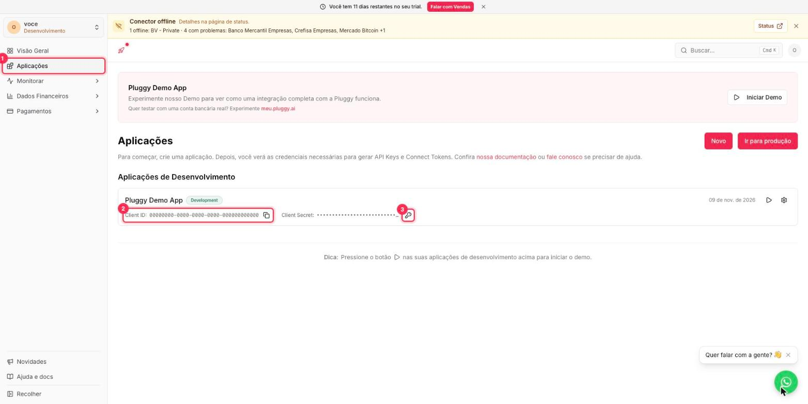

| # | Onde | O que fazer |
|---|---|---|
| 1 | **Aplicações** | abre a lista de aplicações |
| 2 | **Client ID** | o ícone ao lado copia. Anote: o script vai pedir |
| 3 | **Gerenciar secret** (chave) | gere um secret. Ele aparece **uma vez só**, então deixe a tela aberta até o passo 5 |

Ignore o que é para empresas: "Solicitar acesso à produção", "Ir para produção", webhooks, due diligence e
"liberar dados reais". O webhook pode ficar em branco, porque o servidor busca os dados sozinho uma vez por dia.

## 2. Meu Pluggy: conectar os bancos

Entre em **[meu.pluggy.ai](https://meu.pluggy.ai)** com o **mesmo e-mail** do dashboard e conecte cada banco e
cartão. O app do banco vai pedir para você aprovar. Essa autorização do Open Finance vale por 1 ano, e o plano
gratuito aceita até 5 conexões.

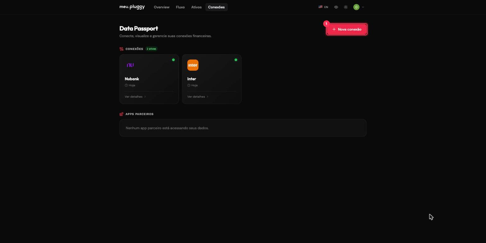

**1. Nova conexão** (na primeira vez o botão se chama "Conectar minha conta"): escolha o banco e siga até a
aprovação no app dele. Repita para cada banco.

## 3. Tailscale: o endereço HTTPS

Crie a conta em **[tailscale.com](https://tailscale.com)**. Dá para entrar com o Google. Depois, no
[Admin console](https://login.tailscale.com/admin):

**a) DNS:** anote o nome do tailnet e ligue o HTTPS.

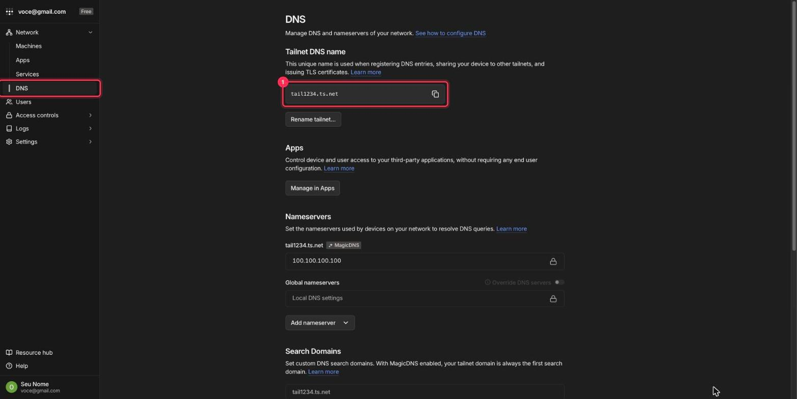

**1. Tailnet DNS name**: algo como `tail1234.ts.net`. É o nome que o script vai pedir.

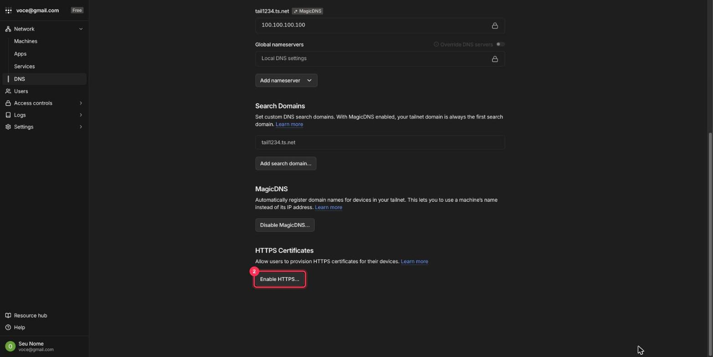

**2. Enable HTTPS…**, mais abaixo na mesma página, e confirme. O MagicDNS precisa estar ligado, como vem por
padrão. O nome do servidor passa a constar em registros públicos de certificados; os seus dados, não.

**b) Access controls → JSON editor:** aplique as regras de [`tailscale/politica.txt`](tailscale/politica.txt).

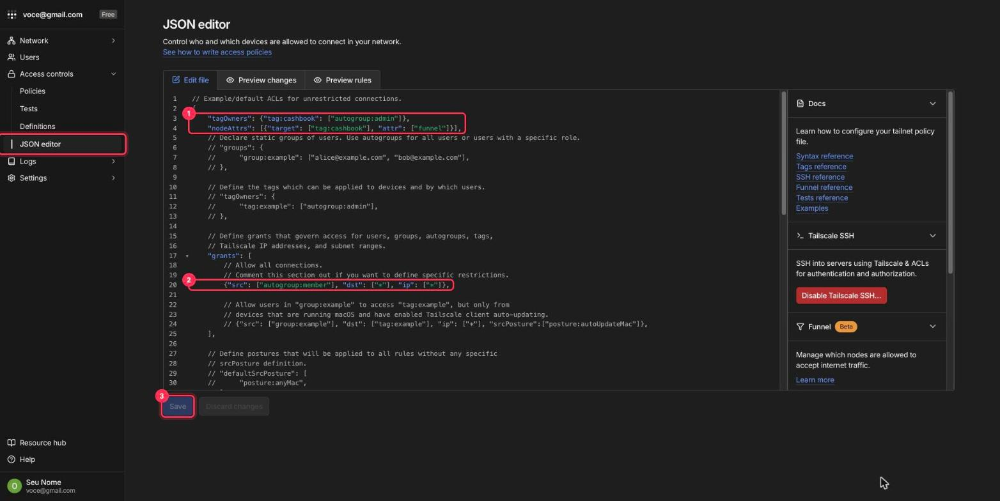

| # | O que fazer |
|---|---|
| 1 | Logo depois da primeira `{`, cole as duas linhas `tagOwners` e `nodeAttrs`. Se o seu arquivo **já tiver** `tagOwners` ou `nodeAttrs`, acrescente as entradas dentro das listas que já existem, sem duplicar a chave |
| 2 | Troque a regra que libera tudo (`"src": ["*"]`) por `"src": ["autogroup:member"]`. Assim o servidor exposto não abre conexão com os seus aparelhos |
| 3 | **Save**. O próprio Tailscale valida o arquivo e mostra o erro se houver |

**c) Settings → Keys → Generate auth key…:**

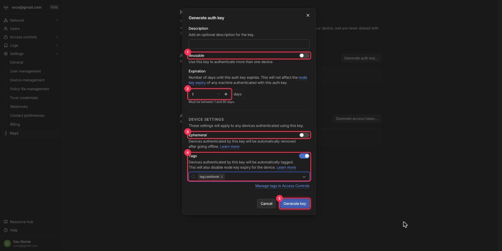

| # | Campo | Valor |
|---|---|---|
| 1 | Reusable | **desligado** |
| 2 | Expiration | **1** dia (você vai usar hoje) |
| 3 | Ephemeral | **desligado** |
| 4 | Tags | **ligado**, com `tag:cashbook` |
| 5 | **Generate key** | deixe a tela da chave aberta até o passo 5 |

Se a chave vencer antes de o servidor subir, gere outra igual e rode
`./instalar.sh guardar tailscale && ./instalar.sh subir`. O `./instalar.sh` sozinho não pergunta de novo,
porque a chave velha continua guardada.

## 4. Google: o login

O seu endereço será `https://cashbook.<seu-tailnet>` (no exemplo, `https://cashbook.tail1234.ts.net`).

1. Em **[console.cloud.google.com](https://console.cloud.google.com)**, crie um projeto (`cashbook-mcp`, por
   exemplo).
2. Abra **Google Auth Platform → Get started** e preencha:
   - App name: `cashbook-mcp`;
   - Support email: o seu;
   - Audience: **External**;
   - Contact: o seu e-mail.

   Depois aceite a política de dados do Google e clique em **Create**.
3. **Branding:**

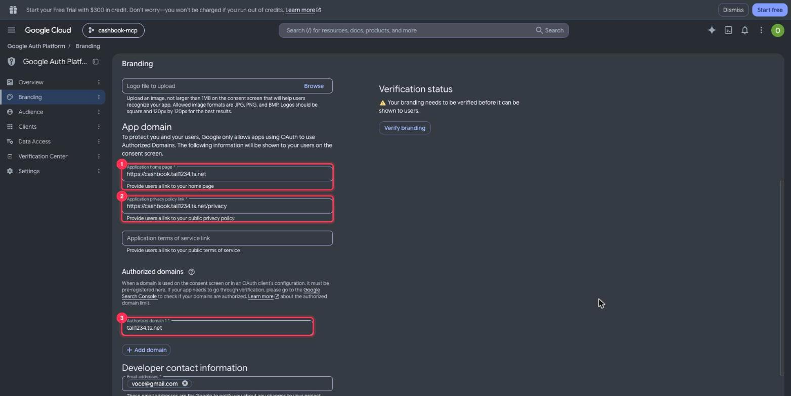

| # | Campo | Valor |
|---|---|---|
| 1 | Application home page | `https://cashbook.<seu-tailnet>` |
| 2 | Application privacy policy link | `https://cashbook.<seu-tailnet>/privacy` (o Google só pede o endereço; ele não precisa abrir nada) |
| 3 | Authorized domains | o seu tailnet, ex.: `tail1234.ts.net` |

Role até o fim da página e clique em **Save**. Sem isso o botão de publicar fica desligado.

4. **Clients → Create client:**

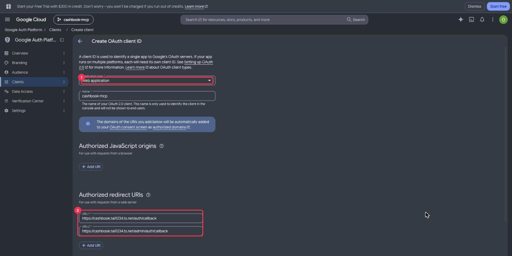

| # | Campo | Valor |
|---|---|---|
| 1 | Application type | **Web application** |
| 2 | Authorized redirect URIs | `https://cashbook.<seu-tailnet>/auth/callback` e `https://cashbook.<seu-tailnet>/admin/auth/callback` |

Clique em **Create**. Na janela que aparece, clique em **Download JSON**. O arquivo
`client_secret_….json` vai para Downloads, e o script o acha sozinho.

5. **Audience → Publish app → Confirm:**

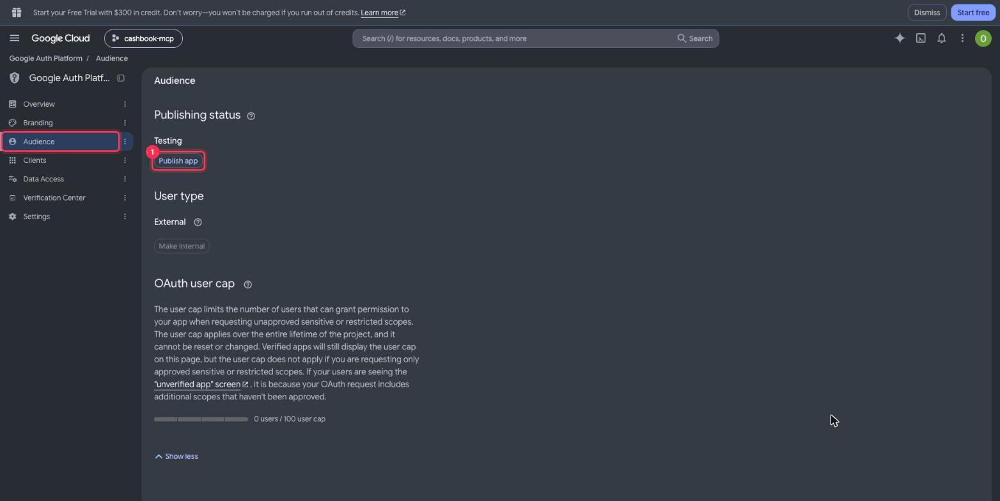

**1. Publish app.** Se o app ficar em "Testing", o login cai toda semana. Publicado, outras contas do Google
até conseguem ver a tela de login, mas o servidor só aceita o seu e-mail.

## 5. Instalar

No Mac, antes, instale e abra o [OrbStack](https://orbstack.dev). No Linux, o Docker precisa estar instalado.

```bash
git clone <este repositório> cashbook-kit
cd cashbook-kit
./instalar.sh
```

O script pergunta o modo. Escolha **1 (na mão)** se já fez os passos acima. Depois ele vai pedindo, um por vez:
as chaves da Pluggy, o nome do tailnet, o seu Gmail, a chave do Tailscale e o JSON do Google.

- **No Mac**, segredo nenhum é colado no terminal. Você copia o valor na página e aperta Enter: o script lê
  da área de transferência e limpa a área depois.
- **No Linux**, você cola o valor e ele não aparece na tela.

O script confere cada coisa na hora: a Pluggy precisa aceitar as chaves, o JSON precisa ter os dois
redirecionamentos e a chave do Tailscale precisa ter o formato certo. Depois ele cria o banco criptografado,
liga o isolamento, sobe tudo e testa o endereço público. Se algo der errado, corrija e rode `./instalar.sh` de
novo: ele continua de onde parou.

## 6. Conectar os bancos no servidor

Abra `https://cashbook.<seu-tailnet>/admin` e entre com o Google. O Google vai avisar "app não verificado":
o app é seu, então clique em **Advanced** e continue.

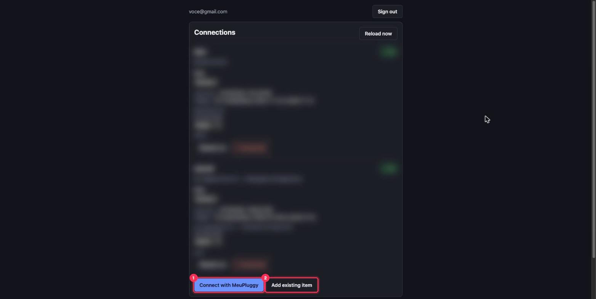

**1. Connect with MeuPluggy**, para o **primeiro** banco. Entre no Meu Pluggy e escolha **um** banco: o Meu
Pluggy compartilha um por vez. Dê um apelido (`inter`, por exemplo) e marque **Personal**.

**2. Add existing item**, **do segundo banco em diante**. O botão 1 passa a ser recusado como duplicado, então
o caminho é este:

a) No dashboard da Pluggy, em **Aplicações**, abra o Demo da sua aplicação:

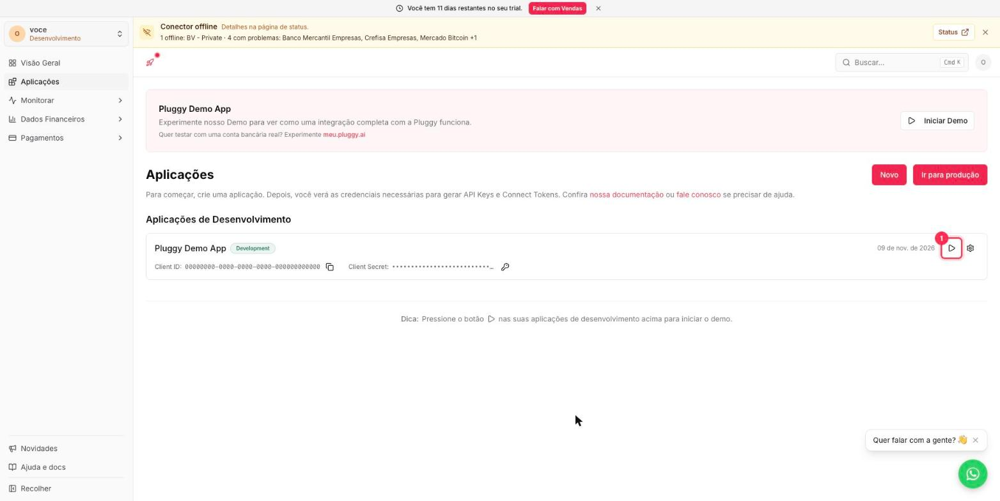

b) No Demo:

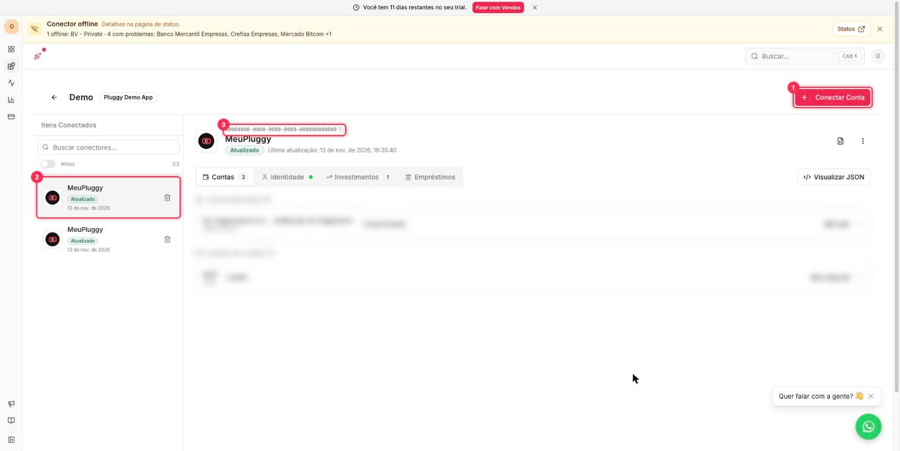

| # | O que fazer |
|---|---|
| 1 | **Conectar Conta** → busque e escolha o conector **MeuPluggy** → entre e escolha o banco. **Não escolha o conector do banco direto**: dá o erro "Contas de teste só podem conectar conectores sandbox" |
| 2 | Clique no item novo da lista "Itens Conectados" |
| 3 | Copie o **ID do item** (o ícone ao lado copia) |

c) De volta ao `/admin` → **Add existing item**:

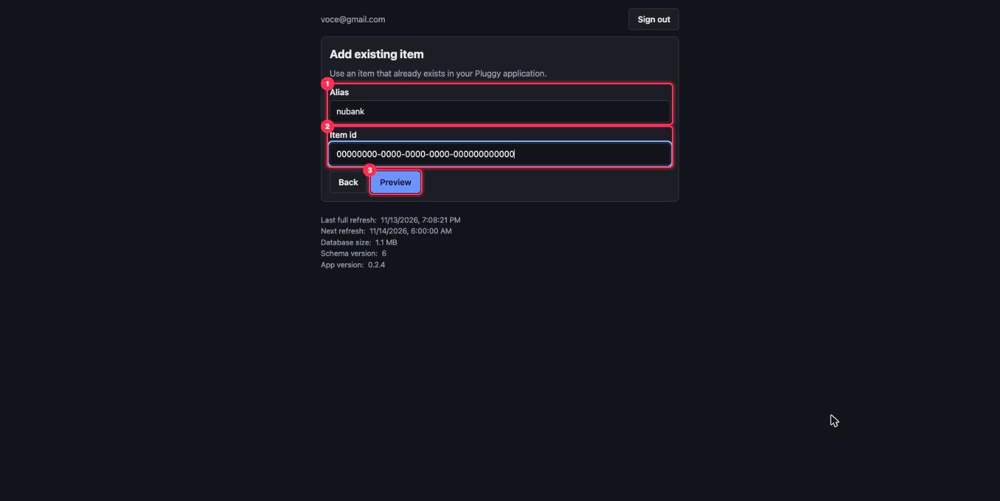

| # | Campo | Valor |
|---|---|---|
| 1 | Alias | um apelido: `nubank`, `itau`… |
| 2 | Item id | o ID copiado |
| 3 | **Preview** | confira o banco e as contas, marque **Personal** e clique em **Add connection** |

O ID que aparece no link do meu.pluggy.ai é outro, da conexão lá dentro, e não serve aqui.
"Disconnect" no `/admin` só tira o banco do servidor: o item continua existindo na Pluggy.

## 7. Ligar no Claude

No **claude.ai → Settings → Connectors → Add custom connector**, use `https://cashbook.<seu-tailnet>/mcp` e
entre com o mesmo Google. Depois pergunte, por exemplo: "me mostra um resumo dos meus gastos do mês".

---

## Bom saber

- **A máquina precisa ficar ligada.** Com ela desligada ou dormindo, o conector sai do ar e a atualização
  diária (06:00) espera. Quando o Docker volta, o servidor sobe sozinho.
- **Os dados atualizam uma vez por dia.** Uma compra de hoje aparece amanhã.
- **O que fica exposto na internet** é só o endereço do Tailscale. `/mcp` e `/admin` exigem o seu login do
  Google, e o container é isolado da sua máquina, da sua rede de casa e dos seus outros aparelhos.
- **Ver se está no ar:** `./instalar.sh status`.
- **Parar:** `cd cashbook-mcp && docker compose -f docker-compose.yml -f examples/tailscale-sidecar/compose.yml down`.
  No Mac, acrescente `-f local/compose.mac-firewall.yml`.
